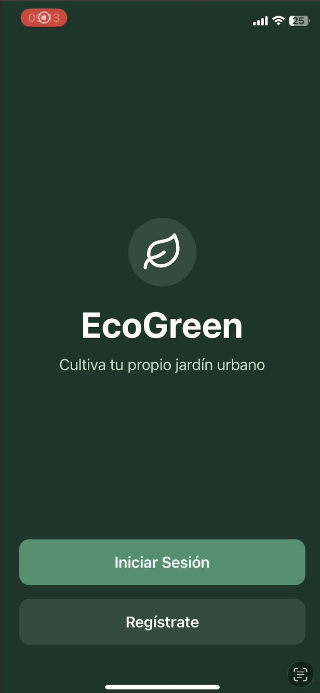
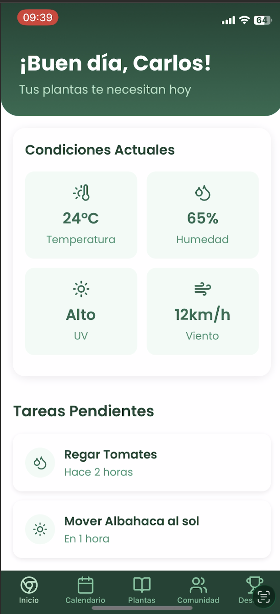
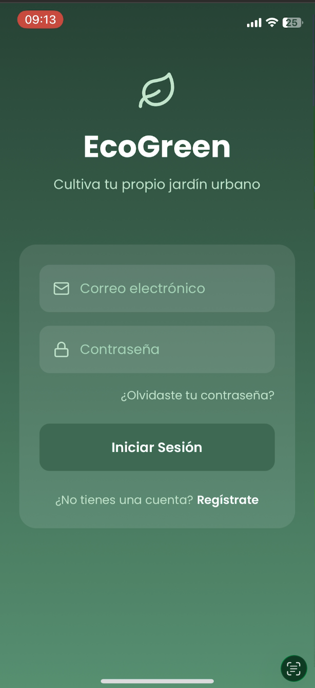
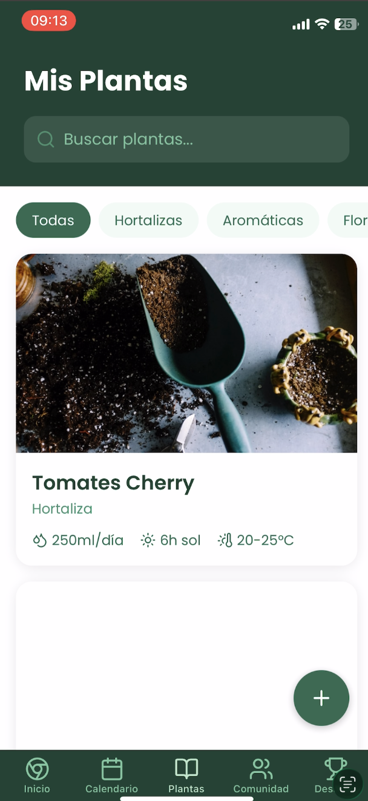
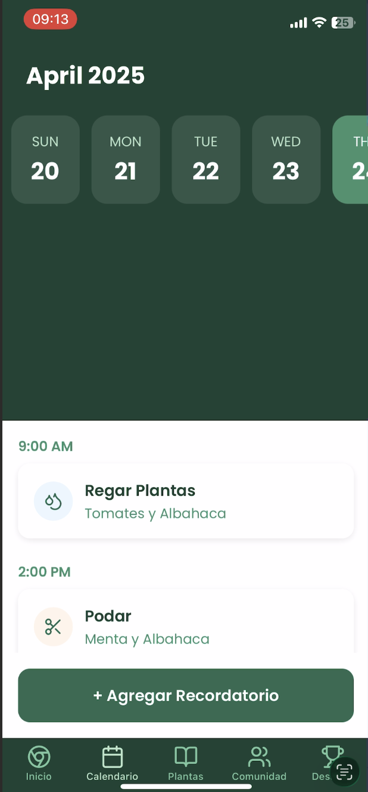
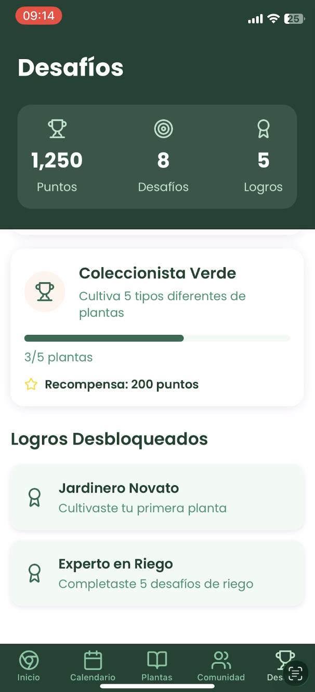
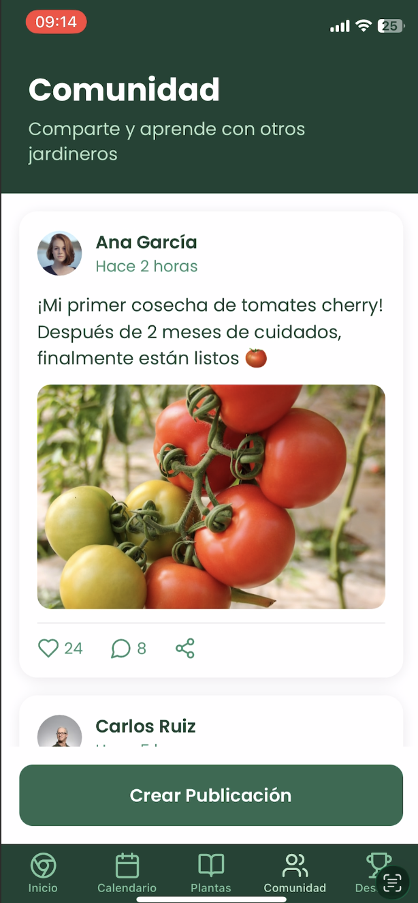

# EcoGreen-portfolio
Una muestra de mi trabajo en EcoGreen, una plataforma digital dedicada al cuidado de las plantas.
# EcoGreen 🌱

Una plataforma digital diseñada para conectar a las personas
con la jardinería urbana y facilitar el cuidado de las plantas.

## Sobre el proyecto

EcoGreen es un proyecto digital enfocado en
promover la jardinería urbana y ayudar a los usuarios
a mantener rutinas constantes en el cuidado de sus plantas.

## Mi rol

- Gestión de proyectos (PM)
- Desarrollo frontend
- Desarrollo backend
- Diseño UI/UX

## Tecnologías

- React Native
- Expo
- TypeScript
- Express.js
- MySQL

## Vista previa

Explora el proyecto en funcionamiento:
https://www.ecogren.online

## Screenshots

### Principal

### Home

### Login

### Bibloteca

### Calendario

### Desafios

### Foro

